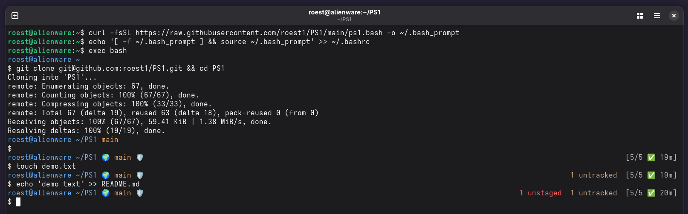

# PS1

A bash prompt that knows about git and GitHub, in one file, with no framework or plugin
manager. It costs one process per prompt.



Top three lines: Fedora's stock prompt. Then the install, a clone, and two edits. The
🌍 and 🛡️ (public repo, protected branch) and the `[5/5 ✅ 19m]` CI status appear one
prompt after `cd`, once GitHub has answered.

## Install

```sh
curl -fsSL https://raw.githubusercontent.com/roest1/PS1/main/ps1.bash -o ~/.bash_prompt
echo '[ -f ~/.bash_prompt ] && source ~/.bash_prompt' >> ~/.bashrc
exec bash
```

To keep up with changes, clone the repo and source `ps1.bash` from the clone instead. For
the GitHub markers and CI status, also install `gh` and `jq` and run `gh auth login`; see
[Requirements](#requirements).

## What it shows

```
user@host ~/path 🌍 main 🛡️                    2 staged  1 unstaged  2 untracked  🔼2 [11/11 ✅ 22h]
$
```

| | |
|---|---|
| 🌍 / 🔒 | repo is public / private |
| 🛡️ | branch has protection rules |
| `2 staged  1 unstaged  2 untracked` | working tree |
| 🔼2&nbsp;🔽3 | commits to push / to pull; both at once means diverged |
| `2 conflicting` | that pull would conflict, in 2 files |
| `main\|MERGING`, `topic\|REBASE 2/5` | a merge, rebase, cherry-pick, revert, bisect or `git am` in progress, in git's own words |
| `1 unmerged` | files that operation left conflicted |
| `[11/11 ✅ 22h]` | GitHub Actions for this commit, last run 22h ago |
| `(base)` | active conda env |

When the window is too narrow, the right side drops segments in priority order rather
than overwrite the left.

## Colors and icons

Set any of these **before** the `source` line in `~/.bashrc`. They are read once, when the
file is sourced, so open a new shell (or `exec bash`) after changing one.

```sh
PS1_COLOR_BRANCH=208          # a 256-color number (0-255) ...
PS1_COLOR_HOST='#9ccfd8'      # ... or a hex color, for a terminal with true color
PS1_ICON_PROTECTED=''         # empty hides that marker
PS1_ICON_AHEAD='↑' PS1_ICON_AHEAD_W=1
[ -f ~/.bash_prompt ] && source ~/.bash_prompt
```

| Color | Default | Paints |
|---|---|---|
| `PS1_COLOR_HOST` | 75 | `user@host` |
| `PS1_COLOR_PATH` | 110 | the working directory |
| `PS1_COLOR_CONDA` | 141 | `(env)` |
| `PS1_COLOR_BRANCH` | 215 | the branch |
| `PS1_COLOR_STAGED` | 150 | `N staged` |
| `PS1_COLOR_UNSTAGED` | 203 | `N unstaged` |
| `PS1_COLOR_UNTRACKED` | 180 | `N untracked` |
| `PS1_COLOR_CONFLICT` | 203, bold | `N conflicting`, `N unmerged` |
| `PS1_COLOR_WARN` | 214 | `[no origin]`, `\|MERGING` and the other operation words |
| `PS1_COLOR_CI` | 250 | the `[11/11 ✅ 22h]` block |

| Icon | Default | Means |
|---|---|---|
| `PS1_ICON_PUBLIC` / `PS1_ICON_PRIVATE` | 🌍 / 🔒 | repo visibility |
| `PS1_ICON_PROTECTED` | 🛡️ | branch has protection rules |
| `PS1_ICON_AHEAD` / `PS1_ICON_BEHIND` | 🔼 / 🔽 | commits to push / to pull |
| `PS1_ICON_CI_PASS` / `_FAIL` / `_RUN` | ✅ / ❌ / ⏳ | GitHub Actions state |

**Widths.** The right side is aligned by counting columns, and bash cannot ask the terminal
how wide a glyph is. Plain ASCII counts its own length; anything else is assumed to be one
double-width emoji. Nerd Font and Material icons are usually one column wide, so give them
`PS1_ICON_<NAME>_W=1`, or the right side lands a column off.

**Emoji need a color emoji font in the terminal you look through**, which is the machine
running the terminal, not the one running the shell: over ssh, your laptop draws them.
WezTerm bundles one and Fedora Workstation installs Noto Color Emoji, so usually there is
nothing to do. Icon fonts (Nerd Fonts, Material) must be installed where the terminal runs,
or their glyphs show as boxes.

A bad color value prints one warning when the file is sourced and keeps the default.
Everything named `__something` in `ps1.bash` is internal and may change; the `PS1_*`
variables above are the interface.

### Inside roest1/dotfiles

There PS1 is a pinned submodule, and the same variables apply. Put them in `~/.bash_local`,
which dotfiles' bashrc loads before the prompt. A future theme manager will write them
from one palette shared with the terminal and editor.

## Requirements

| Needs | For | Without it |
|---|---|---|
| bash 5, `git` | everything | — |
| `gh`, **logged in** (`gh auth login`) | 🌍 / 🔒 / 🛡️ | those parts are simply not drawn |
| the same, plus `jq` | the `[11/11 ✅ 22h]` block | it is simply not drawn |
| a color emoji font in the terminal | the emoji | boxes instead of emoji |

`gh` answers nothing without a login, even for a public repo, so on a fresh machine the
prompt shows only `user@host path branch` until you log in. On Fedora:
`sudo dnf install gh jq && gh auth login`. `GH_PROMPT=0` before sourcing turns the GitHub
parts off on purpose.

**What appears, and when.** The right side lists only what is true: a clean, up-to-date
clone has no `staged`/`untracked`/🔼 to show, so it is blank apart from the CI block.
GitHub's answers are fetched in the background and arrive **one prompt later**: `cd` into a
repo, press Enter once, and the markers and CI status appear.

## How it stays fast

Anything that needs the network or a real merge is read from a cache that a detached job
refreshes, so pressing Enter never waits on GitHub. "GitHub had no answer" is cached too,
for a minute, so a repo with no workflows or a commit not pushed yet does not cost an API
call per Enter. Inside a repo, one
`git status --porcelain=v2 --branch` answers everything else; outside one, nothing forks.
The caches live in `$XDG_RUNTIME_DIR/ps1` (or `~/.cache/ps1`), private to you.
The comments in [`ps1.bash`](ps1.bash) explain each choice. For how bash builds a prompt in the first
place, and which of your system's files set what, see
[How your prompt is built](docs/how-your-prompt-is-built.md).

**What it costs.** `git status` dominates. Measured on a ThinkPad T16 Gen 4 (Ryzen AI 7
PRO 350, Fedora 44), in one sitting; expect ±10% between runs, and different numbers on
your machine:

| Where | Per Enter | Of which `git status` |
|---|---|---|
| outside any repo | 0.1 ms | — (not run) |
| this repo | 5.4 ms | 3.2 ms (59%) |
| a repo with one submodule | 8.1 ms | 6.1 ms (74%) |

The rest, about 2 ms, is bash reading the caches and building the line, and it is the
same in every repo. `git status` is the part that grows: with tracked files, untracked
directories, and one more `git` for each submodule.

**Against the alternatives**, the whole prompt per Enter in this repo. Every row includes
Fedora's stock setup, because it stays when you install a prompt. Most of its 1.2 ms is
systemd's terminal hook (see [How your prompt is built](docs/how-your-prompt-is-built.md)).

| Prompt | Per Enter |
|---|---|
| Fedora's stock prompt, no git information | 1.2 ms |
| + git's own `__git_ps1`, branch only | 6.3 ms |
| **+ ps1.bash**, everything above plus GitHub | **6.7 ms** |
| + `__git_ps1` with dirty, untracked and upstream | 21.2 ms |

To measure your own, from the directory you care about:

```sh
./time-prompt.sh                 # from a clone; or, installed with curl:
bash <(curl -fsSL https://raw.githubusercontent.com/roest1/PS1/main/time-prompt.sh)
./time-prompt.sh --compare       # also: your stock prompt, and git's __git_ps1
```

It times the function bash runs on every Enter, then `git status` alone. `--compare` times
whole prompts in a clean shell set up the way a new account on your machine starts.

## License

MIT.
